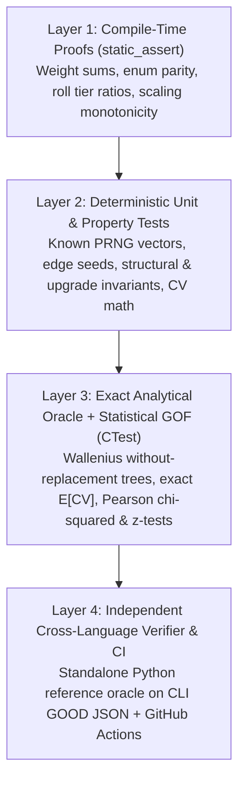

# Automated Mathematical Verification Plan for `gi-artifact-engine`

## Goal Description

Following the removal of `cpp/sanity_check.cpp`, `gi-artifact-engine` needs a principled, automated, and reproducible system to verify that every mathematical and probabilistic component matches both its internal specifications and Genshin Impact's documented artifact rules.

The previous `sanity_check.cpp` checked basic structural invariants (substat count, uniqueness, main-stat exclusion, final level) and printed the empirical 4-liner rate for manual inspection, but it did not assert statistical accuracy, did not test the PRNG or weighted sampling math, and was not wired into `ctest` or CI.

This plan proposes a **4-Layer Automated Math Verification Pyramid**:



### Key Findings from the Codebase Math Audit

Inspecting all headers (`random_utils.hpp`, `distributions.hpp`, `generator.hpp`, `simulator.hpp`, `main.cpp`) already uncovered concrete mathematical issues that an automated verification suite will immediately catch:

1. **64-bit vs. 32-bit mismatch in Lemire's `fastUniform` ([random_utils.hpp](file:///C:/Users/gab/Documents/Projects/gi-artifact-engine/cpp/artifact/random_utils.hpp#L63-L83)):**
   `m` is a 128-bit product of a 64-bit RNG value `x` and `ubound`, returning `m >> 64`. However, the rejection check truncates `l = static_cast<uint32_t>(m)` and computes `uint32_t threshold = -ubound % ubound` ($2^{32} \bmod \text{bound}$) instead of using `uint64_t` ($2^{64} \bmod \text{bound}$). For large bounds like `900,000,000` (used in `generateArtifactId`), this causes ~16.2% spurious rejections and breaks exact Lemire unbiasedness; for small bounds (e.g., `5`), it rejects $2^{32}$ inputs instead of $1$.
2. **All-zero absorbing state in `Xoshiro256` seeding ([random_utils.hpp](file:///C:/Users/gab/Documents/Projects/gi-artifact-engine/cpp/artifact/random_utils.hpp#L21-L33)):**
   The constructor reuses `z` instead of incrementing a separate SplitMix64 state by `GOLDEN_RATIO_CONST` on each iteration. If `seed == 0x61c8864680b583ebULL` ($2^{64} - \text{GOLDEN\_RATIO\_CONST}$), `z` wraps to `0` and initializes `s = {0, 0, 0, 0}`, permanently bricking `Xoshiro256` so `operator()` returns `0` forever.
3. **Unchecked enum-order coupling in `isMainStatConflict` ([distributions.hpp](file:///C:/Users/gab/Documents/Projects/gi-artifact-engine/cpp/artifact/distributions.hpp#L175-L178)):**
   Relies on the first 10 entries of `ArtifactMainStat` matching `ArtifactSubstat` in identical order, with no `static_assert` enforcing parity against `mainStatToSubStat`.
4. **Unused domain drop constants in `simulator.hpp` ([simulator.hpp](file:///C:/Users/gab/Documents/Projects/gi-artifact-engine/cpp/simulation/simulator.hpp#L16-L26)):**
   `DOUBLE_5_STAR_CHANCE` (6.5%) and `SET_SPLIT_RATE` (50%) are defined in `distributions.hpp` but not applied in `runSimulation`, which currently generates exactly 1 artifact per 20-resin run.
5. **Floating-point precision details ([generator.hpp](file:///C:/Users/gab/Documents/Projects/gi-artifact-engine/cpp/artifact/generator.hpp#L20-L31), [generator.hpp](file:///C:/Users/gab/Documents/Projects/gi-artifact-engine/cpp/artifact/generator.hpp#L260)):**
   - `calculateCritValue` accumulates into `float` instead of `double`.
   - Repeated `+= rollSubstatValue(...)` additions accumulate IEEE-754 representation drift (e.g., `23.310000000000002`) when exported to GOOD JSON.

---

## User Review Required

> [!IMPORTANT]
> **Scope of PRNG Fixes vs. Test-Only Implementation:**
> Implementing the verification suite will immediately fail on the two PRNG bugs identified in [random_utils.hpp](file:///C:/Users/gab/Documents/Projects/gi-artifact-engine/cpp/artifact/random_utils.hpp) (`Xoshiro256` zero-state seed and `fastUniform` 32/64-bit Lemire rejection). Please confirm whether you want this plan to **include fixing those two bugs** (recommended, so the suite goes red-to-green) or **only add the tests** first.

> [!NOTE]
> **Test Framework Choice:**
> CMake already uses `FetchContent` for `nlohmann/json`. We can either:
> - **Option A (Recommended):** Use **zero-dependency C++20 CTest executables** (tiny shared `tests/test_common.hpp` with clean assertion macros and exact statistical utilities). Zero extra network downloads, instant rebuilds, works offline with MSYS2 `g++` and Linux `g++`.
> - **Option B:** Fetch **doctest** (single-header C++ test framework) or **Catch2 v3** via `FetchContent` for rich assertion expressions and test-case filtering.

---

## Open Questions

1. **Test framework preference:** Do you prefer **zero-dependency C++20 CTest executables** (Option A) or fetching **doctest / Catch2** via `FetchContent` (Option B)?
2. **Bug fixes in scope:** Should we fix the `Xoshiro256` SplitMix64 seeding and 64-bit Lemire `fastUniform` bugs alongside adding the verification suite?
3. **Layer 4 (Python + GitHub Actions):** Would you like both the **independent stdlib-only Python verifier** (`scripts/verify_math.py`, which cross-checks exported GOOD JSON & CLI stats without sharing any C++ tables) and a **GitHub Actions workflow** (`.github/workflows/ci.yml`), or C++/CTest only for now?
4. **Simulator model expectations:** Should simulator verification test the current 1-artifact-per-run behavior (leaving `DOUBLE_5_STAR_CHANCE` and `SET_SPLIT_RATE` as future tests), or do you plan to wire those constants into `simulator.hpp` soon?

---

## Proposed Changes

### Component 1: Compile-Time Mathematical Proofs (`static_assert`)

Compile-time checks guarantee that distribution tables, enum mappings, roll tiers, and scaling bounds cannot silently regress.

#### [MODIFY] [distributions.hpp](file:///C:/Users/gab/Documents/Projects/gi-artifact-engine/cpp/artifact/distributions.hpp)
- Add `static_assert` checks for `FLOWER_MAIN_STATS` and `FEATHER_MAIN_STATS` summing to `100.0` (matching Sands/Goblet/Circlet).
- Add `constexpr` validation helpers proving at compile time:
  - Every main-stat weight is strictly positive and no duplicate `ArtifactMainStat` appears within any slot's weight array.
  - `ALL_SUBSTATS` has 10 unique substats, all weights > 0, and sum of all substat weights == `44`.
  - `isMainStatConflict(m, s)` agrees with `mainStatToSubStat(m) == s` across all `19 x 10` `(ArtifactMainStat, ArtifactSubstat)` pairs.
  - Every substat's 4 roll tiers satisfy `0 < t[0] < t[1] < t[2] < t[3]` and match `{0.7, 0.8, 0.9, 1.0} * t[3]` within `0.01`.
  - Every valid 5-star main stat has `0 < base < max`, exact `level == 0` / `level == 20` endpoints, and strictly increasing values across levels `0..20`.

---

### Component 2: PRNG & Uniform Sampling Math Fixes *(subject to user approval)*

#### [MODIFY] [random_utils.hpp](file:///C:/Users/gab/Documents/Projects/gi-artifact-engine/cpp/artifact/random_utils.hpp)
- Fix `Xoshiro256(uint64_t seed)` to use standard SplitMix64 state progression (`uint64_t state = seed;` incrementing `state += GOLDEN_RATIO_CONST` before mixing each of `s[0..3]`), guaranteeing that no 64-bit seed (including `0x61c8864680b583ebULL`) can produce an all-zero state:
```cpp
explicit Xoshiro256(uint64_t seed) {
    uint64_t state = seed;
    for (int i = 0; i < 4; ++i) {
        state += GOLDEN_RATIO_CONST;
        uint64_t z = state;
        z = (z ^ (z >> 30)) * MIXER_MULTIPLIER_1;
        z = (z ^ (z >> 27)) * MIXER_MULTIPLIER_2;
        s[i] = z ^ (z >> 31);
    }
}
```
- Fix `fastUniform` to use 64-bit `l` and 64-bit `threshold` for 64-bit Lemire rejection sampling:
```cpp
inline uint32_t fastUniform(int32_t bound, Xoshiro256 &rng) {
    assert(bound > 0 && "Bound must be a positive integer");

    const uint64_t ubound = static_cast<uint64_t>(bound);
    uint64_t x = rng();

    __uint128_t m = static_cast<__uint128_t>(x) * ubound;
    uint64_t l = static_cast<uint64_t>(m);

    if (l < ubound) {
        const uint64_t threshold = (-ubound) % ubound;
        while (l < threshold) {
            x = rng();
            m = static_cast<__uint128_t>(x) * ubound;
            l = static_cast<uint64_t>(m);
        }
    }

    return static_cast<uint32_t>(m >> 64);
}
```

---

### Component 3: C++ Automated Math Verification Suite (`tests/` + CTest)

Register all test executables with CMake's `enable_testing()` and `add_test(...)` so `ctest --test-dir build --output-on-failure` executes the entire verification pyramid in under ~1 second.

#### [NEW] `tests/math_oracle.hpp`
An independent analytical reference oracle and statistical testing toolkit:
- **Exact Wallenius Without-Replacement Combinatorial Solver:**
  Enumerates all ordered $k$-draws ($k = 3$ and $k = 4$) from the remaining substat pool given any main stat $M$:
  $$P(s_1, \dots, s_k \mid M) = \prod_{r=1}^{k} \frac{w(s_r)}{W(M) - \sum_{j=1}^{r-1} w(s_j)}$$
  Computes in <1 ms:
  - Exact marginal probability $P(s \in \text{substats} \mid M, k)$ for every substat $s$.
  - Exact joint probability $P(\text{CR} \land \text{CD} \mid M, k)$.
  - Exact expected +20 Crit Value per main stat $M$ and overall:
    $$E[\text{CV}_{+20} \mid M] = 2.05 \times \Big(6.610 \cdot P(\text{CR} \in S_4 \mid M) + 6.605 \cdot P(\text{CD} \in S_4 \mid M)\Big)$$
    For example:
    - Flower (`hpFlat`) / Feather (`atkFlat`): $P(\text{CR}) = P(\text{CD}) = 0.342010$, $P(\text{both}) = 0.091562$, $E[\text{CV}_{+20}] = 9.265311$
    - ATK%/HP%/DEF%/ER/EM Sands: $P(\text{CR}) = P(\text{CD}) = 0.328248$, $P(\text{both}) = 0.083424$, $E[\text{CV}_{+20}] = 8.892485$
    - Elemental Goblet: $P(\text{CR}) = P(\text{CD}) = 0.294198$, $P(\text{both}) = 0.066932$, $E[\text{CV}_{+20}] = 7.970040$
    - Crit Rate Circlet: $P(\text{CR}) = 0$, $P(\text{CD}) = 0.320256$, $E[\text{CV}_{+20}] = 4.336346$
- **Statistical Hypothesis Test Helpers:**
  - **Pearson's Chi-Squared ($\chi^2$) Goodness-of-Fit** with regularized upper incomplete gamma $Q(\text{df}/2, \chi^2/2)$ to compute exact $p$-values (and fail if $p < \alpha$, e.g., $\alpha = 10^{-4}$ for deterministic CI runs, printing observed vs. expected tables on failure).
  - **Two-Sided Binomial Z-Test** for Bernoulli rates (e.g., 4-liner rate $p = 0.20$) and **Sample Mean Z-Test** ($\bar{x}$ vs. analytical $\mu$ using $\text{SE} = s/\sqrt{N}$).

#### [NEW] `tests/test_prng.cpp`
Deterministic + statistical verification of [random_utils.hpp](file:///C:/Users/gab/Documents/Projects/gi-artifact-engine/cpp/artifact/random_utils.hpp):
- **Known-Answer Reference Test:** Verify `Xoshiro256` output sequence against official Blackman & Vigna `xoshiro256**` reference transitions.
- **Seed Edge Cases:** Test `seed = 0`, `1`, `42`, `UINT64_MAX`, and `0x61c8864680b583ebULL` (verifying non-zero, non-degenerate outputs).
- **Range & Determinism:** Verify `fastUniform(bound)` stays within `[0, bound - 1]` (including `bound = 1`, powers of 2, primes, `900000000`), `fastUniformDouble` stays strictly within `[0.0, 1.0)`, and identical seeds yield identical streams.
- **Uniformity $\chi^2$ Tests:**
  - `fastUniform(bound)` across `bound ∈ {3, 4, 5, 7, 10, 44, 100}` ($N = 200{,}000$ each).
  - `fastUniformDouble` across 100 equal bins on `[0, 1)` ($N = 200{,}000$) plus mean ($0.5$) and variance ($1/12$) z-tests.

#### [NEW] `tests/test_invariants.cpp`
Replaces and significantly expands the old `sanity_check.cpp`:
- **Structural Invariants across 50,000 generated + upgraded artifacts:**
  - Valid slot, main stat belongs to that slot's valid table, rarity == 5, initial level == 0.
  - 3 or 4 unique substats at level 0; no substat conflicts with `mainStat`; each initial substat value exactly equals one of the 4 tiers in `getSubstatValues`; initial `rolls == 1`.
  - After every `upgradeArtifactOnce`: level increases by `+4`, `mainStat.type` unchanged, `mainStat.value == getMainStatValue(type, level)`, `substatCount == 4`, all 4 substats remain distinct and non-conflicting.
  - At level 20: total `rolls` == `8` for initial 3-liners and `9` for initial 4-liners; every substat value lies within `[rolls * tier[0], rolls * tier[3]]` and is realizable as a sum of `rolls` discrete tier values (within floating-point epsilon).
- **Exact Formula Unit Tests:**
  - `calculateCritValue`: zero-crit artifact (`0.0`), CR-only, CD-only, mixed, and theoretical max 54.45 CV (`6 * 3.89 * 2 + 7.77 = 54.45`).
  - `getMainStatValue`: clamping at `level <= 0` and `level >= 20`, linearity at intermediate levels.
  - `goodexport::artifactToGood`: schema completeness and exact enum-to-GOOD key mapping.

#### [NEW] `tests/test_statistics.cpp`
Large-sample ($N = 250{,}000$, fixed seed, runs in <0.5 s) statistical goodness-of-fit tests comparing the live C++ engine against `math_oracle.hpp`:
1. **Slot Distribution ($\chi^2$, df = 4):** Uniform 20% across Flower/Feather/Sands/Goblet/Circlet.
2. **Main Stat Distributions ($\chi^2$):**
   - Flower (100% HP flat) & Feather (100% ATK flat) — exact 100% assertion.
   - Sands (df = 4), Goblet (df = 11), Circlet (df = 6) vs. official percentages.
3. **4-Liner Spawn Rate (Binomial Z-test):** Empirical rate vs. $p = 0.20$.
4. **Weighted-Without-Replacement Substat Math (Exact Wallenius Oracle):**
   - First-picked substat distribution ($\chi^2$) for `hpFlat`, `atkPercent`, `critRate`, and `pyroDmg` main stats.
   - Exact marginal presence probabilities of all 10 substats in initial 3-liners, initial 4-liners, and upgraded +20 4-substat sets (testing each substat's z-score AND joint CR+CD co-occurrence rate against exact Wallenius values!).
   - Verification that a 3-liner upgraded at +4 has the exact same 4-substat distribution as a native 4-liner.
5. **Substat Roll Tier Uniformity ($\chi^2$, df = 3):** Equal 25% probability across the 4 roll tiers for every one of the 10 substat types.
6. **Upgrade Targeting & Roll-Count Distribution ($\chi^2$):**
   - Upgrade index uniformity (`0, 1, 2, 3` at 25% each, df = 3).
   - Final per-line roll count distribution vs. exact $1 + \text{Binomial}(4, 1/4)$ for 3-liners and $1 + \text{Binomial}(5, 1/4)$ for 4-liners.
7. **End-to-End Analytical Crit Value Verification (Mean Z-Test):**
   - Compare empirical mean +20 CV (overall and per-slot) against exact analytical $E[\text{CV}_{+20}]$, confirming the full pipeline (slot $\to$ main stat $\to$ 3/4-liner $\to$ weighted substats $\to$ roll tiers $\to$ 5 upgrades $\to$ CV) composes accurately with zero subtle compounding bias.

#### [MODIFY] [CMakeLists.txt](file:///C:/Users/gab/Documents/Projects/gi-artifact-engine/CMakeLists.txt)
- Add `option(BUILD_TESTING "Build math verification tests" ON)` and `include(CTest)`.
- Register `test_prng`, `test_invariants`, and `test_statistics` targets (with `-Wall -Wextra -Wpedantic` / `/W4`) and wire them into `add_test(...)`.
- Add a CTest target for `check_headers` compilation or keep it in build scripts so zero warnings are enforced.

#### [NEW] `windows-scripts/test.ps1` & `linux-scripts/test.sh`
- Convenience scripts to configure, build, run `check_headers`, and execute `ctest --test-dir build --output-on-failure` (and optionally run `scripts/verify_math.py`).

---

### Component 4: Independent Cross-Language Verifier & CI Automation *(optional)*

#### [NEW] `scripts/verify_math.py`
A zero-dependency Python 3 script (standard library only: `json`, `math`, `subprocess`, `itertools`, `collections`) that treats `gi_artifact_engine` as a **black box**:
- Encodes Genshin Impact's official Wiki/GOOD drop tables **independently** from `distributions.hpp` (catches any typo in C++ constants that C++ self-tests might share!).
- Invokes `./build/gi_artifact_engine --no-clear --seed 2026 --resin 200000 --topk 10000 --out <tmp.json> --luck`.
- Parses both stdout (verifying `--luck` z-score math independently from reported totals) and the exported GOOD JSON array.
- Runs independent $\chi^2$ / z-tests on slots, main stats, substat marginals, and mean CV, printing a clean human-readable Pass/Fail summary table with exact $p$-values and exiting non-zero on any failure.
- Also checks determinism (running twice with the same `--seed` yields identical JSON output).

#### [NEW] `.github/workflows/ci.yml`
- Runs on push and pull requests (Linux `g++` + Windows MSYS2/MinGW or MSVC matrix):
  1. CMake configure & build (`gi_artifact_engine`, `check_headers`, and test targets).
  2. `ctest --test-dir build --output-on-failure`.
  3. `python scripts/verify_math.py`.

---

## Verification Plan

### Automated Tests
Once approved and implemented, all verification runs via:
```powershell
# Windows (PowerShell / MSYS2 MinGW)
cmake -G "MinGW Makefiles" -B build -DCMAKE_BUILD_TYPE=Release
cmake --build build
cmake --build build --target check_headers
ctest --test-dir build --output-on-failure --verbose
python scripts/verify_math.py
```
```bash
# Linux
cmake -B build -DCMAKE_BUILD_TYPE=Release
cmake --build build
cmake --build build --target check_headers
ctest --test-dir build --output-on-failure --verbose
python3 scripts/verify_math.py
```

### Negative / Mutation Sanity Checks (Verifying the Tests Themselves)
During implementation, we will verify test sensitivity by confirming:
1. Before fixing `random_utils.hpp`, `test_prng` genuinely fails on `seed = 0x61c8864680b583ebULL` (and catches the 32-bit Lemire rejection bug), then passes cleanly after the fix.
2. Temporarily perturbing a single weight (e.g., changing Crit Rate substat weight from `3` to `4` or 4-liner chance from `0.20` to `0.21`) causes `test_statistics` to fail decisively with an explicit $\chi^2$ / $z$-score diagnostic.

### Manual Verification
- Review the formatted statistical summary output from `ctest --verbose` and `scripts/verify_math.py` to confirm all $p$-values are healthy (not borderline) and runtime stays fast (<1–2 seconds total).
